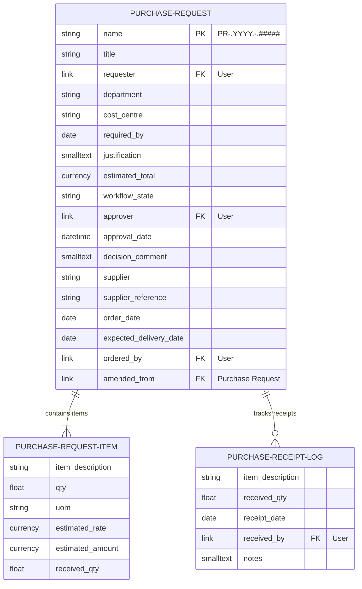
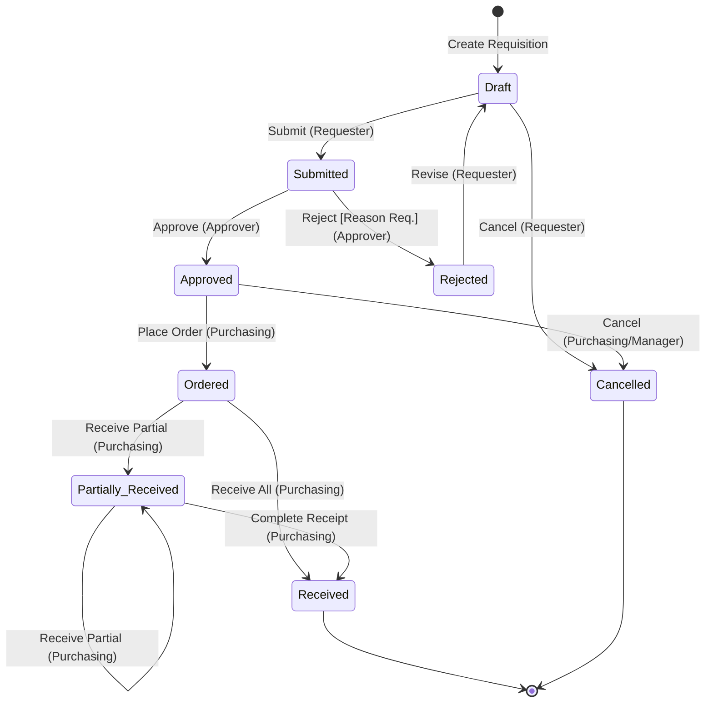

# Purchase Request Workflow System

A procurement and approval workflow application built on the **Frappe Framework (v13)** and **ERPNext**. 

The system centralizes purchase requests from initial employee requisition to multi-tier approval, purchase ordering, and goods receipt tracking—enforcing strict business rules, segregation of duties, automated notifications, and real-time executive reporting.

---

## Table of Contents
- [1. Overview & Objectives](#1-overview--objectives)
- [2. System Architecture & Data Model](#2-system-architecture--data-model)
- [3. Workflow & Lifecycle](#3-workflow--lifecycle)
- [4. Role & Permission Matrix](#4-role--permission-matrix)
- [5. Business Rules & Server-Side Validations](#5-business-rules--server-side-validations)
- [6. Goods Receipt Tracking & Over-Receipt Guard](#6-goods-receipt-tracking--over-receipt-guard)
- [7. Automated Notifications](#7-automated-notifications)
- [8. Executive Reports & Analytics](#8-executive-reports--analytics)
- [9. Installation & Bench Setup](#9-installation--bench-setup)
- [10. Known Limitations & Future Enhancements](#10-known-limitations--future-enhancements)

---

## 1. Overview & Objectives

In organizations lacking automated procurement, purchase requests are often handled haphazardly across email, chat, or spreadsheets. This leads to budget overruns, lack of transparency on approvals, duplicate orders, and unverified deliveries.

### Key Objectives:
- **Requisition:** Employees submit itemized requests with business justifications and required-by dates.
- **Segregation of Duties:** Requesters are strictly barred from approving or rejecting their own requests.
- **Procurement Tracking:** Purchasing staff capture supplier, PO references, and order dates.
- **Goods Receipt Ledger:** Supports partial and multiple shipments, preventing over-receipt.
- **Visibility:** Real-time Script Report with KPI summary cards and spend breakdown by department.

---

## 2. System Architecture & Data Model

The application is structured around a parent DocType and two child DocTypes:



### DocType Summary:
1. **`Purchase Request` (Parent):**
   * Autonaming: Series `PR-.YYYY.-.#####` (e.g. `PR-2026-00001`).
   * Managed by custom state machine (`Purchase Request Approval Flow`).
2. **`Purchase Request Item` (Child Table):**
   * Stores line items, requested quantities, unit rates, and tracks cumulative received quantities.
3. **`Purchase Receipt Log` (Child Table):**
   * An append-only audit table logging discrete physical delivery events.

---

## 3. Workflow & Lifecycle

The lifecycle follows an 8-state, 10-transition state machine:



### State Configuration Details:
| State | DocStatus | Allowed Role | Next Transition / Action |
| :--- | :---: | :--- | :--- |
| **Draft** | `0` | Purchase Requester | `Submit` $\rightarrow$ Submitted, `Cancel` $\rightarrow$ Cancelled |
| **Submitted** | `0` | Purchase Approver | `Approve` $\rightarrow$ Approved, `Reject` $\rightarrow$ Rejected |
| **Approved** | `0` | Purchase Officer | `Place Order` $\rightarrow$ Ordered, `Cancel` $\rightarrow$ Cancelled |
| **Rejected** | `0` | Purchase Requester | `Revise` $\rightarrow$ Draft |
| **Ordered** | `0` | Purchase Officer | `Receive Partial` $\rightarrow$ Partially Received, `Receive All` $\rightarrow$ Received |
| **Partially Received** | `0` | Purchase Officer | `Receive Partial` $\rightarrow$ Partially Received, `Complete Receipt` $\rightarrow$ Received |
| **Received** | `1` | Purchase Officer | Terminal state (Submitted) |
| **Cancelled** | `0` | Purchase Requester / Officer | Terminal state |

---

## 4. Role & Permission Matrix

Access control enforces the principle of least privilege:

| DocType / Action | Purchase Requester | Purchase Approver | Purchase Officer | System Manager |
| :--- | :---: | :---: | :---: | :---: |
| **Create PR** | ✅ | ❌ | ❌ | ✅ |
| **Edit Draft PR** | ✅ (Own only) | ❌ | ❌ | ✅ |
| **Approve / Reject PR** | ❌ *(Blocked server-side)* | ✅ | ❌ | ✅ |
| **Enter Order Details** | ❌ | ❌ | ✅ | ✅ |
| **Log Goods Receipts** | ❌ | ❌ | ✅ | ✅ |
| **View Reports** | ✅ | ✅ | ✅ | ✅ |

---

## 5. Business Rules & Server-Side Validations

All critical validations run in Python (`purchase_request.py`) during `validate()` to prevent client-side bypass:

1. **Required-By Date Guard:**
   * Prevents requisitions with past required-by dates:
     `if getdate(self.required_by) < getdate(nowdate()): throw()`
2. **Item Sanity Checks:**
   * Must have at least 1 item line.
   * `qty > 0` and `estimated_rate >= 0`.
3. **Total Calculation Security:**
   * Line totals (`qty * estimated_rate`) and document `estimated_total` are dynamically re-calculated on both client and server.
4. **Segregation of Duties:**
   * An employee cannot approve or reject a PR where `requester == frappe.session.user`.
5. **Rejection Reason Mandate:**
   * Rejections require a populated `decision_comment` explaining the refusal.
6. **Automated Order Tracking:**
   * When transitioned to `Ordered`, the system auto-stamps `order_date` and `ordered_by`.

---

## 6. Goods Receipt Tracking & Over-Receipt Guard

Receipt tracking provides complete traceability for physical deliveries without external ERP overhead:

* Each delivery is recorded as a row in the `receipt_logs` table (`Purchase Receipt Log`).
* The controller aggregates all receipts per item:
  $$\sum \text{received\_qty} \le \text{requested qty}$$
* **Over-Receipt Protection:** Attempting to record more units than requested raises a hard `ValidationError`.
* **Dynamic Status Progression:**
  * If $\sum \text{received} < \text{total requested}$: State automatically moves to `Partially Received`.
  * If $\sum \text{received} = \text{total requested}$: State automatically advances to `Received`.

---

## 7. Automated Notifications

Configured via Frappe's built-in Notification engine to send alerts without code bloat:

| Notification Name | Trigger Condition | Recipients | Channel |
| :--- | :--- | :--- | :---: |
| **PR Submitted for Approval** | `workflow_state == "Submitted"` | Role: `Purchase Approver` | System Notification (Bell 🔔) |
| **PR Decision Notification** | `workflow_state in ["Approved", "Rejected"]` | Field: `owner` (Requester) | System Notification (Bell 🔔) |
| **PR Goods Received** | `workflow_state == "Received"` | Field: `owner`, Role: `Purchase Approver` | System Notification (Bell 🔔) |

---

## 8. Executive Reports & Analytics

The **Purchase Request Summary** Script Report (`/app/query-report/Purchase Request Summary`) offers complete operational visibility:

* **Interactive Filters:**
  * Date Range (`from_date`, `to_date`)
  * Status (`workflow_state`)
  * Department (`department`)
  * Requester (`requester`)
* **KPI Summary Cards:**
  * 🟦 **Total Requests:** Total count of requisitions matching filters.
  * 🟩 **Total Estimated Spend:** Aggregate financial value.
  * 🟧 **Pending Approvals:** Real-time count of requests awaiting manager signoff.
  * 🟥 **Overdue Requests:** Open requests where `required_by < today`.
* **Dashboard Chart:**
  * Dynamic bar chart rendering total estimated spend grouped by department.

---

## 9. Installation & Bench Setup

To deploy this application on an existing Frappe Bench environment:

```bash
# 1. Navigate to bench directory
cd ~/frappe-bench

# 2. Get the app (or clone repository into apps/)
bench get-app purchase_request_workflow https://github.com/<your-username>/purchase_request_workflow.git

# 3. Install app on your site
bench --site <site-name> install-app purchase_request_workflow

# 4. Run database migrations
bench --site <site-name> migrate

# 5. Clear bench cache
bench --site <site-name> clear-cache
```

---

## 10. Known Limitations & Future Enhancements

* **Multi-Currency Support:** Currently defaults to company base currency. Future iterations can integrate live exchange rates.
* **Tiered Approval Limits:** Single-level approval currently implemented. A future enhancement could route requests exceeding ₹1,00,000 to a Department Head or Finance Director.
* **ERPNext Purchase Order Conversion:** Direct one-click conversion from `Purchase Request` into ERPNext core `Purchase Order` and `Purchase Receipt` DocTypes.

---

## License
MIT License. Created for the Frappe Framework Intern Development Project.
